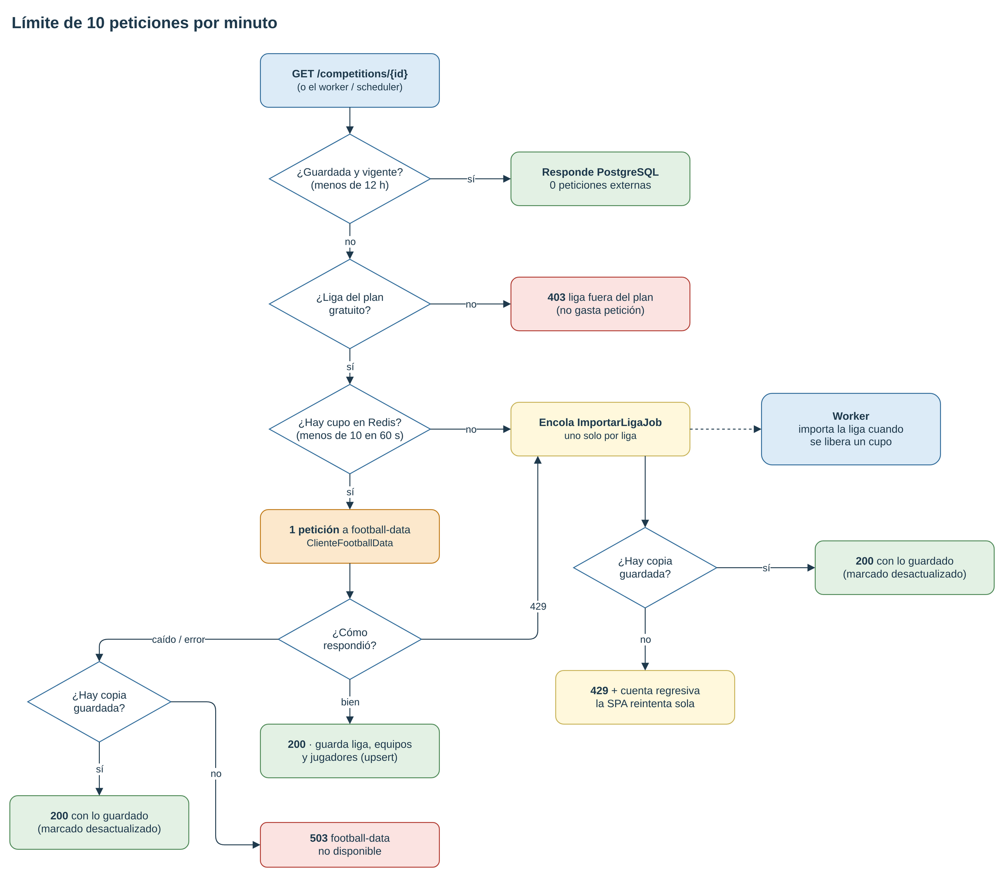
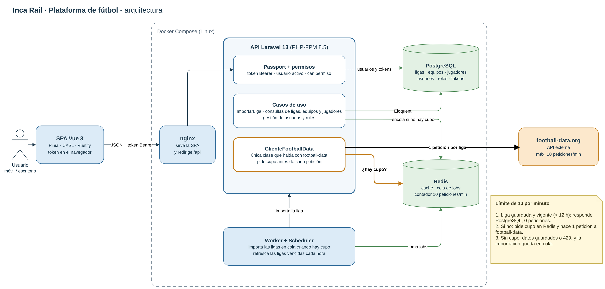
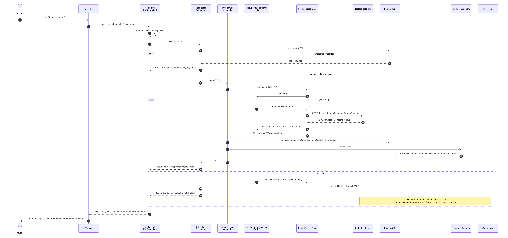
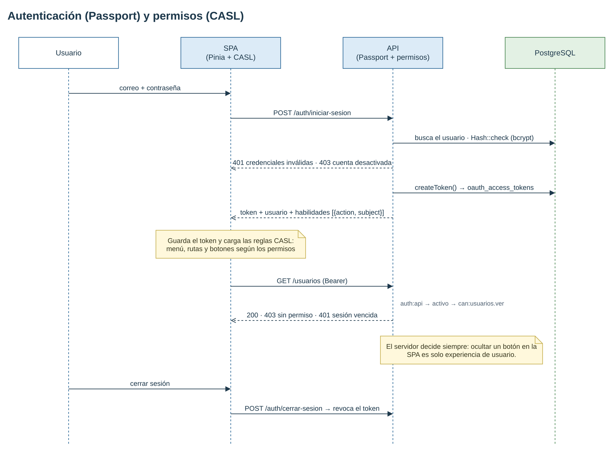
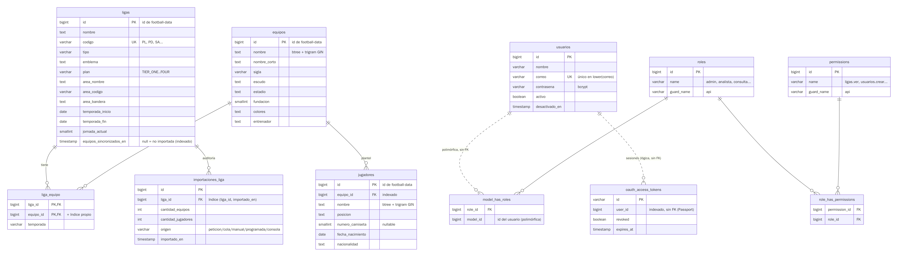

# Inca Rail · Plataforma de fútbol (prueba técnica Senior Full Stack)

API REST en **Laravel 13 / PHP 8.5** con **Passport** y control de acceso por roles y permisos, que consume
[football-data.org](https://www.football-data.org) y guarda una copia propia con **Eloquent** (PostgreSQL),
más una **SPA en Vue 3** (TypeScript, Vue Router, Pinia, Vuetify y CASL) para iniciar sesión, consultar ligas,
equipos y jugadores, y administrar usuarios, roles y permisos.

| | |
|---|---|
| **Backend** | Laravel 13.35 · PHP 8.5 · Passport 13 · spatie/laravel-permission 8 · PostgreSQL 17 · Redis 7 |
| **Frontend** | Vue 3.5 · TypeScript · Vue Router · Pinia · Vuetify 4 · CASL · Vite |
| **Infra** | Docker Compose: nginx + PHP-FPM, worker de colas, scheduler, PostgreSQL y Redis (Linux/Alpine) |
| **Calidad** | 87 pruebas PHPUnit (unitarias, integración y aceptación), 10 de Vitest, Pint, ESLint/Oxlint, Prettier, GitHub Actions |

---

## Índice

1. [Puesta en marcha (Docker)](#1-puesta-en-marcha-docker)
2. [Usuarios de prueba](#2-usuarios-de-prueba)
3. [Puesta en marcha sin Docker](#3-puesta-en-marcha-sin-docker)
4. [Variables de entorno](#4-variables-de-entorno)
5. [La API](#5-la-api)
6. [El límite de 10 peticiones por minuto](#6-el-límite-de-10-peticiones-por-minuto)
7. [Cómo abordé la solución y por qué](#7-cómo-abordé-la-solución-y-por-qué)
8. [Diagramas](#8-diagramas)
9. [Frontend](#9-frontend)
10. [Pruebas, TDD e integración continua](#10-pruebas-tdd-e-integración-continua)
11. [Supuestos](#11-supuestos)
12. [Pendiente y cómo lo haría](#12-pendiente-y-cómo-lo-haría)
13. [Estructura del repositorio](#13-estructura-del-repositorio)

---

## 1. Puesta en marcha (Docker)

**Requisitos:** Docker 24+ con Docker Compose v2, ~3 GB libres en disco y un token gratuito de
football-data.org ([registro](https://www.football-data.org/client/register)).

```bash
git clone <url-del-repositorio> incarail && cd incarail

cp .env.example .env
# Edita .env y pega tu token:  FOOTBALL_DATA_TOKEN=tu_token

docker compose up -d --build
```

La primera vez tarda unos minutos (instala dependencias y compila la SPA). Cuando `docker compose ps`
muestre `app` como `healthy`:

| Qué | Dónde |
|---|---|
| **SPA** | <http://localhost:8081> |
| **API** | <http://localhost:8001> (p. ej. `POST /auth/iniciar-sesion`, `GET /competitions`) |
| Salud de la API | <http://localhost:8001/up> |

No hay pasos ocultos: el contenedor `app` ejecuta `php artisan app:instalar`, un comando idempotente que corre
las migraciones, genera las llaves de Passport, crea el cliente de tokens personales y siembra roles,
permisos y usuarios de prueba. La `APP_KEY` se genera una vez y se guarda en el volumen de `storage`.

Si los puertos 8081 u 8001 están ocupados, cámbialos en `.env` (`SPA_PORT`, `API_PORT`).

```bash
docker compose logs -f app worker        # ver la instalación y las importaciones en cola
docker compose exec app php artisan test # correr las pruebas dentro del contenedor
docker compose down                      # detener (añade -v para borrar también los datos)
```

> Sin token la plataforma igual arranca: el inicio de sesión, la administración y los datos ya guardados funcionan, y
> las pantallas que necesitan football-data muestran el error `503 football_data_sin_configurar`.

## 2. Usuarios de prueba

Contraseña de todos: **`password`** (la pantalla de inicio de sesión tiene accesos rápidos).

| Usuario | Rol | Puede |
|---|---|---|
| `admin@incarail.test` | `admin` | Todo: ligas, equipos, jugadores, usuarios, roles y permisos |
| `analista@incarail.test` | `analista` | Ver ligas, equipos y jugadores; forzar la importación de ligas en segundo plano |
| `consulta@incarail.test` | `consulta` | Solo consulta: ver ligas, equipos y jugadores |

## 3. Puesta en marcha sin Docker

Requisitos: PHP 8.5 (extensiones `pdo_pgsql` o `pdo_sqlite`, `intl`, `bcmath`), Composer 2, Node 24 y,
opcionalmente, PostgreSQL y Redis.

```bash
# API
cd backend
composer install
cp .env.example .env            # pon FOOTBALL_DATA_TOKEN y tus credenciales de base de datos
#   Sin PostgreSQL/Redis: DB_CONNECTION=sqlite (y borra los demás DB_*),
#   CACHE_STORE=database y QUEUE_CONNECTION=database; luego: touch database/database.sqlite
php artisan key:generate
php artisan app:instalar         # migraciones + llaves Passport + seeders
php artisan serve --port=8001    # API en http://localhost:8001
php artisan queue:work           # en otra terminal: importaciones en segundo plano
php artisan schedule:work        # opcional: refresco programado

# SPA
cd ../frontend
cp .env.example .env             # VITE_API_BASE_URL=http://localhost:8001
npm ci
npm run dev                      # http://localhost:5173
```

## 4. Variables de entorno

Hay dos plantillas, ninguna con secretos:

- **`.env.example`** (raíz) — lo lee `compose.yml`: `FOOTBALL_DATA_TOKEN`, `SPA_PORT`, `API_PORT`.
- **`backend/.env.example`** — configuración completa de Laravel para correrlo sin Docker.

| Variable | Por defecto | Para qué |
|---|---|---|
| `FOOTBALL_DATA_TOKEN` | — | Token personal de football-data.org. Solo en `.env`, nunca en el código ni en el repositorio. |
| `FOOTBALL_DATA_MAX_REQUESTS_PER_MINUTE` | `10` | Presupuesto de peticiones salientes por minuto. |
| `FOOTBALL_DATA_AVAILABLE_PLANS` | `TIER_ONE` | Planes de football-data que el token puede leer (el gratuito solo `TIER_ONE`). |
| `FOOTBALL_COMPETITIONS_TTL_MINUTES` | `1440` | Cada cuánto se considera vencido el catálogo de ligas. |
| `FOOTBALL_COMPETITION_DETAIL_TTL_MINUTES` | `720` | Cada cuánto se considera vencida una liga importada. |
| `PASSPORT_TOKEN_TTL_MINUTES` | `480` | Vida del token de acceso emitido al iniciar sesión. |
| `CORS_ALLOWED_ORIGINS` | `http://localhost:5173,http://localhost:8081` | Orígenes que pueden llamar a la API desde el navegador. |

## 5. La API

Las rutas no llevan prefijo `/api`, para respetar **exactamente** las del enunciado (`/competitions`, `/team`,
`/players`); el resto está en español. Todas, salvo el inicio de sesión, exigen `Authorization: Bearer <token>`,
un usuario activo y un permiso.

| Método | Ruta | Permiso | Descripción |
|---|---|---|---|
| `POST` | `/auth/iniciar-sesion` | público (5 intentos/min) | Correo + contraseña → token, usuario y reglas CASL |
| `GET` | `/auth/sesion` | sesión | Usuario y reglas CASL (para restaurar la sesión al recargar) |
| `POST` | `/auth/cerrar-sesion` | sesión | Revoca el token |
| `GET` | **`/competitions`** | `ligas.ver` | Todas las ligas. Filtros: `buscar`, `area`, `disponibles`, `importadas` |
| `GET` | **`/competitions/{competition_id}`** | `ligas.ver` | Detalle de una liga (por id `2021` o código `PL`). **Al consultarla se guardan sus equipos y jugadores** |
| `GET` | **`/team`** | `equipos.ver` | Equipos guardados, paginados. Filtros: `buscar`, `liga_id`, `por_pagina`, `page` |
| `GET` | **`/team/{team_id}`** | `equipos.ver` | Detalle de un equipo con su plantel y sus ligas |
| `GET` | **`/players`** | `jugadores.ver` | Jugadores guardados, paginados. Filtros: `buscar`, `equipo_id`, `posicion`, `nacionalidad`, `orden`, `direccion` |
| `GET` | `/players/{player_id}` | `jugadores.ver` | Detalle de un jugador (extra) |
| `POST` | `/competitions/{competition_id}/importar` | `ligas.importar` | Encola una actualización en segundo plano → `202` (extra) |
| `GET/POST` | `/usuarios` | `usuarios.ver` / `usuarios.crear` | Listar (con `buscar`) y crear usuarios |
| `GET/PUT` | `/usuarios/{id}` | `usuarios.ver` / `usuarios.editar` | Ver y editar (nombre, correo, contraseña, roles) |
| `PATCH` | `/usuarios/{id}/desactivar` · `/activar` | `usuarios.desactivar` | Desactivar (revoca sus tokens al instante) y reactivar |
| `GET/POST` | `/roles` | `roles.ver` / `roles.gestionar` | Listar y crear roles |
| `PUT/DELETE` | `/roles/{id}` | `roles.gestionar` | Editar permisos de un rol, eliminarlo |
| `GET` | `/permisos` | `roles.ver` | Catálogo de permisos con su equivalente CASL |

Respuesta del inicio de sesión (las `habilidades` se usan tal cual con CASL, que exige las claves `action` y
`subject`):

```json
{
  "tipo_token": "Bearer",
  "token_acceso": "eyJ0eXAiOiJKV1Qi...",
  "expira_en": "2026-10-10T14:00:00+00:00",
  "usuario": { "id": 3, "nombre": "Carla Consulta", "correo": "consulta@incarail.test", "activo": true, "roles": ["consulta"] },
  "habilidades": [
    { "action": "ver", "subject": "Equipo" },
    { "action": "ver", "subject": "Jugador" },
    { "action": "ver", "subject": "Liga" }
  ]
}
```

### Errores: un solo formato

Todos los errores salen con la misma forma y el código HTTP que corresponde. `codigo` es estable (para
programas) y `mensaje` es para personas:

```json
{ "error": { "estado": 429, "codigo": "football_data_limite_alcanzado",
  "mensaje": "football-data.org permite 10 consultas por minuto y ya se usaron. La importación quedó en cola y estará lista en unos 42 segundos.",
  "detalles": { "reintentar_en": 42, "en_cola": true } } }
```

| HTTP | `codigo` | Cuándo |
|---|---|---|
| 401 | `no_autenticado` · `credenciales_invalidas` | Sin token, token vencido o revocado · credenciales incorrectas |
| 403 | `sin_permiso` · `cuenta_desactivada` · `liga_fuera_del_plan` | Falta el permiso · usuario desactivado · liga fuera del plan gratuito |
| 404 | `no_encontrado` · `liga_no_encontrada` | Equipo, jugador, usuario o rol inexistente («El equipo solicitado no existe.») · liga inexistente en football-data |
| 409 | `conflicto` | Regla de negocio: desactivarse a sí mismo, dejar el sistema sin administradores, borrar un rol en uso |
| 422 | `validacion_fallida` | Datos inválidos; `detalles.campos` trae los mensajes por campo |
| 429 | `demasiadas_solicitudes` · `football_data_limite_alcanzado` | Límite de nuestra API (120/min por usuario) · sin cupo hacia football-data (con `Retry-After`) |
| 502 | `football_data_error` | football-data respondió con un error inesperado |
| 503 | `football_data_no_disponible` · `football_data_sin_configurar` | Sin conexión con football-data (timeout, DNS…) · falta el token |

Ejemplo rápido con `curl`:

```bash
TOKEN=$(curl -s -X POST localhost:8001/auth/iniciar-sesion -H 'Content-Type: application/json' \
  -d '{"correo":"analista@incarail.test","contrasena":"password"}' | jq -r .token_acceso)

curl -s "localhost:8001/competitions?disponibles=1" -H "Authorization: Bearer $TOKEN" | jq '.data[].codigo'
curl -s localhost:8001/competitions/PL               -H "Authorization: Bearer $TOKEN" | jq '.data.equipos | length'
curl -s "localhost:8001/players?posicion=Goalkeeper" -H "Authorization: Bearer $TOKEN" | jq '.meta.total'
curl -s localhost:8001/team/999999               -H "Authorization: Bearer $TOKEN"   # 404 con formato uniforme
```

## 6. El límite de 10 peticiones por minuto

**La idea central: nuestra base de datos es la fuente de las respuestas; football-data solo la alimenta.**
Una vez guardada, una liga se responde sin llamar afuera, y cada llamada externa pasa por un presupuesto
compartido que nunca deja salir más de 10 peticiones en ningún intervalo de 60 segundos.



Lo que hace cada pieza:

1. **Datos locales primero (read-through).** `GET /team`, `/team/{id}` y `/players` *nunca* llaman a
   football-data. `GET /competitions` y `GET /competitions/{id}` responden desde PostgreSQL si los datos están
   frescos (catálogo: 24 h; liga: 12 h). Solo si faltan o vencieron se intenta refrescarlos.
2. **Importar una liga cuesta 1 petición.** `/v4/competitions/{id}/teams` trae la competición, sus equipos y
   el plantel de cada uno. Diez clics en diez ligas distintas consumen el minuto; volver a abrirlas no cuesta
   nada.
3. **Presupuesto compartido con ventana deslizante** (`PresupuestoVentanaDeslizante`). Antes de cada petición el
   adaptador pide un cupo. El registro de las últimas peticiones vive en **Redis** bajo un **lock atómico**,
   así los procesos web, el worker y el scheduler gastan el mismo presupuesto y no hay carreras. Elegí ventana
   deslizante y no fija porque una ventana fija permite 20 peticiones en 2 segundos alrededor del cambio de
   minuto (10 a las 00:59 y 10 a las 01:00).
4. **football-data manda.** Tras cada respuesta se leen `X-Requests-Available-Minute` y
   `X-RequestCounter-Reset`. Si dicen 0, o si llega un `429`, el presupuesto se bloquea hasta el reset que
   ellos indican. Así nos corregimos aunque otro cliente use el mismo token.
5. **Sin cupo, nada se pierde.** Si no hay cupo, la importación se encola (`ImportarLigaJob`, único por
   liga para no duplicar). El job usa la misma lógica; si sigue sin cupo hace `release(reintentarEn)` y vuelve a
   la cola justo cuando se libera un lugar. Mientras tanto:
   - si ya había una copia (aunque vencida) se responde **200 con `meta.desactualizado: true`**;
   - si no había nada, **429** con `Retry-After` y `en_cola: true`. La SPA muestra la cuenta regresiva y
     **reintenta sola**; para entonces el worker suele haber terminado y la respuesta sale de la base.
6. **No gastar cupo en lo imposible.** El catálogo trae el `plan` de cada liga; las que no son `TIER_ONE`
   (fuera del plan gratuito) se rechazan con 403 sin llamar a football-data, y la SPA las muestra
   deshabilitadas.
7. **Caída de football-data.** Timeout o error de red → se sirve la copia local si existe (`desactualizado`); si no,
   `503` (o `502` si respondió con error). Lo ya guardado siempre se responde, con o sin football-data y con o
   sin token.
8. **En segundo plano.** El scheduler sincroniza el catálogo una vez al día y encola cada hora el refresco de
   las ligas vencidas. Los jobs se autorregulan con el mismo presupuesto.

**Lo probé así:** `EndpointsFutbolTest::la_undecima_importacion_del_minuto_no_se_envia_y_queda_en_cola_con_429`
abre 11 ligas seguidas y verifica que salen exactamente 10 peticiones, que la 11.ª responde 429 con
`Retry-After` y que su importación queda en cola. Otras pruebas cubren la ventana deslizante
(`PresupuestoVentanaDeslizanteTest`), la lectura de cabeceras y el `429` del proveedor
(`ClienteFootballDataTest`), el `release` del job (`ImportarLigaJobTest`) y el servicio con
football-data caído (`AnalistaExploraUnaLigaTest`).

**Alternativas que descarté:**
- *Solo caché HTTP de las respuestas:* evita repetir llamadas, pero no controla ráfagas de ligas distintas ni
  sirve datos cuando la caché expira y el proveedor no está.
- *`sleep()` entre llamadas dentro del request:* bloquea workers de PHP-FPM y el usuario espera hasta un minuto.
- *Importar todo por adelantado con un cron:* el plan gratuito tiene 12 ligas y ~20 equipos por liga; sería
  viable, pero contradice «al consultarla se guardan» y gasta cupo en ligas que nadie pidió. Lo dejé como
  refresco de lo ya importado.
- *Middleware `RateLimited` de Laravel para jobs:* sirve para los jobs pero no para las llamadas síncronas;
  con un solo presupuesto propio ambos caminos comparten la misma regla.

## 7. Cómo abordé la solución y por qué

### Arquitectura: hexagonal solo donde paga (O2 · O5)

| Opción | A favor | En contra para este proyecto |
|---|---|---|
| **Capas simples de Laravel** (controlador → modelo) | Mínimo código, idiomático | La integración con football-data y el límite se mezclarían con controladores y modelos; difícil de probar sin HTTP |
| **Clean Architecture completa** | Dominio totalmente independiente | Entidades propias + repositorios + mapeos para un CRUD de lectura: mucho código que no aporta |
| **Hexagonal (puertos y adaptadores) pragmática** ✅ | Aísla lo que realmente varía y falla (el proveedor externo); se prueba con un adaptador en memoria | Requiere disciplina para no sobrediseñar el resto |

Elegí **hexagonal aplicada solo a la frontera que lo justifica**:

- **Dominio** (`app/Dominio/Futbol`): el **puerto** `ProveedorDatosFutbol`, DTOs inmutables
  (`DatosLiga`, `DatosEquipo`, `DatosJugador`, `PlantelesLiga`), excepciones de dominio y el evento
  `LigaImportada`. No conoce HTTP, Laravel HTTP ni el formato JSON de football-data.
- **Infraestructura** (`app/Infraestructura/FootballData`): el **adaptador** `ClienteFootballData`, la única clase
  que habla HTTP con football-data (mapea el JSON a DTOs y los errores HTTP a excepciones de dominio), y el
  `PresupuestoVentanaDeslizante`.
- **Aplicación** (`app/Aplicacion`): casos de uso. En las pruebas el puerto se reemplaza por
  `ProveedorFutbolEnMemoria` (un segundo adaptador), sin tocar el código de aplicación.
- **Eloquent sin repositorios.** Los modelos son el modelo de persistencia y de lectura. Ponerles un repositorio
  delante no aislaría nada valioso: Eloquent ya es la abstracción de la base y el enunciado pide usarlo.
  Por eso elegí hexagonal y no Clean Architecture «de libro».

### CQRS ligero (O3)

- **Comandos** (escriben): `ImportarLiga`, `SincronizarCatalogoLigas`, `GestionUsuarios`, `GestionRoles`.
- **Consultas** (solo leen): `CatalogoLigas`, `DetalleLiga`, `ConsultasEquipos`, `ConsultasJugadores`.
  Devuelven el dato y su procedencia (`ResultadoConsulta`: `fuente`, `desactualizado`, `sincronizado_en`), que la
  API expone en `meta`.

No separé bases de lectura y escritura: con este volumen sería sobrediseño. La separación ya aporta: las
consultas no tienen efectos y los comandos son los únicos que gastan cupo de football-data.

### Eventos y colas (O4 · O18)

- `LigaImportada` se emite tras cada importación y tiene dos listeners. `RegistrarImportacionLiga` guarda la
  auditoría (`importaciones_liga`), que la SPA muestra como «última importación». `OlvidarPosicionesJugadores`
  invalida la caché del filtro de posiciones. Otro consumidor (por ejemplo, avisar) se agrega sin tocar el caso de
  uso.
- `ImportarLigaJob` (`ShouldBeUnique` por liga, `retryUntil` de 2 h, `release` según `reintentarEn`).
- Scheduler: `futbol:sincronizar-ligas` (diario), `futbol:refrescar-vencidas` (cada hora) y `passport:purge`
  (diario). También existe `php artisan futbol:importar PL PD SA [--cola]` para cargar ligas desde la consola.

### Datos (B4)

- Las **claves primarias son los ids de football-data**. Cada importación es un `upsert` de Eloquent por id, así
  que consultar la misma liga dos veces **no duplica** nada (hay pruebas que lo verifican). La relación
  liga–equipo es un pivote `liga_equipo` con la temporada; un equipo puede estar en varias ligas
  (Premier League y Champions).
- De cada jugador se guarda nombre, posición, número de camiseta, fecha de nacimiento y nacionalidad.
- Sin SQL escrito a mano en las consultas: migraciones, modelos, relaciones, *scopes* (`#[Scope]`) y `upsert`.
  La única sentencia SQL literal es un DDL de migración (índice único sobre `lower(correo)`) que el *schema
  builder* de Laravel no puede expresar. Ver [Base de datos](#base-de-datos-revisión-y-rendimiento).

### Base de datos: revisión y rendimiento

Revisé el esquema como DBA: estructura real en PostgreSQL, el SQL exacto que genera Eloquent y su plan de
ejecución (`EXPLAIN ANALYZE`) con un volumen sintético de **200 ligas, 5.000 equipos, 10.000 vínculos
liga–equipo, 150.000 jugadores y 20.000 registros de importación**.

| Caso de uso | Antes¹ | Ahora² | Causa y corrección |
|---|---|---|---|
| Detalle de liga (equipos + n.º de jugadores) | 654 ms | 9 ms | PostgreSQL no indexa las FK por sí solo: contaba jugadores recorriendo los 150.000 por cada equipo → índice en `jugadores(equipo_id)` |
| Equipos de una liga (paginado) | 264 ms | 8 ms | Misma causa → índices en `jugadores(equipo_id)` y `liga_equipo(equipo_id)` |
| Buscar jugadores por texto | 144 ms | 7 ms | `ILIKE '%texto%'` no usa un B-tree → índice **trigram** (`pg_trgm`, GIN) en `jugadores.nombre` |
| Buscar equipos por texto | 247 ms | 39 ms | Trigram en `equipos.nombre` (la búsqueda también mira `nombre_corto` y `sigla`) |
| Listado de ligas con n.º de equipos | 210 ms | 12 ms | `withCount('equipos')` unía la tabla `equipos` completa solo para contar → se cuentan las filas del pivote (`vinculosEquipos`) |
| Filtro de posiciones (`DISTINCT`) | 58 ms | ≈0 ms | Caché que se invalida con el evento `LigaImportada` |

¹ `EXPLAIN ANALYZE` de la consulta principal. ² Suma de todas las consultas del caso de uso, ejecutando el código y la
migración reales (las mediciones se hicieron antes de pasar los nombres a español; el esquema y los índices son
los mismos). Las pruebas de `tests/Feature/BaseDeDatos` fijan estas reglas: toda FK de las tablas de fútbol tiene
índice, existen los índices trigram (en PostgreSQL), el correo es único sin importar mayúsculas, etc.

Otras correcciones de la revisión:

- **Textos externos en `text`, no en `varchar(255)`.** Nombres, URLs de escudos, direcciones o colores vienen de
  football-data y no los controlamos. Un valor de más de 255 caracteres hacía fallar *toda* la importación de la
  liga (`value too long for type character varying(255)`, reproducido en una prueba). En PostgreSQL `text` y
  `varchar` rinden igual. Los códigos de formato conocido (`PL`, `ARS`, `TIER_ONE`) mantienen tipos cortos.
- **Importaciones concurrentes de la misma liga** (una petición y el job en cola): el vínculo liga–equipo se
  escribe con `upsert` sobre la clave compuesta, en lugar de `sync()` (que lee, borra e inserta y podía chocar con la
  PK). Además, las filas se escriben ordenadas por id para que dos transacciones bloqueen en el mismo orden y no haya
  *deadlocks*.
- **Correo único sin importar mayúsculas** a nivel de base (`unique (lower(correo))`), además de normalizarlo en el
  modelo. Ese índice ya cubre la unicidad simple, así que no hay otro índice único sobre `correo`.
- **Índices sin valor eliminados:** el de `posicion` (pocos valores distintos; PostgreSQL prefiere el de
  `equipo_id`) y el de `plan` (con ~190 filas PostgreSQL lee la tabla completa igual).
- **`oauth_access_tokens` no crece sin límite:** cada inicio de sesión crea un token; `passport:purge` corre a diario y borra
  los revocados y vencidos.

Decisiones que revisé y mantuve:

- **Ids de football-data como PK** (en lugar de un id propio más uno externo): hacen la importación idempotente con
  `ON CONFLICT` y evitan una búsqueda por cada fila.
- **El pivote guarda la temporada vigente**, no el historial: su PK es `(liga_id, equipo_id)`. Si se quisiera
  conservar temporadas anteriores, `temporada` pasaría a formar parte de la PK.
- **`area_*` desnormalizado** en ligas y equipos: es un modelo de lectura de datos externos y una tabla `areas`
  añadiría un JOIN sin beneficio.
- **Sin FK hacia `usuarios`** en `model_has_roles` (polimórfica, de spatie) ni en `oauth_access_tokens` (Passport):
  así los definen esos paquetes, y la API nunca borra usuarios, solo los desactiva y revoca sus tokens.
- **`timestamp` sin zona horaria** (el valor por defecto de Laravel): correcto mientras la aplicación trabaje en
  UTC, como está configurada.

### Idioma del código y de la base de datos

Todo lo propio está en español: tablas y columnas (`ligas`, `equipos`, `liga_equipo`, `jugadores`,
`importaciones_liga`, `usuarios`; `nombre`, `numero_camiseta`, `creado_en`…), clases, métodos y variables, permisos
(`ligas.ver`), claves JSON y códigos de error de la API, rutas propias, comandos artisan, pruebas y la SPA.

Se mantiene en inglés solo lo que no depende de nosotros, para no mezclar idiomas dentro de una misma pieza:

- **Las cinco rutas del enunciado** (`/competitions`, `/competitions/{competition_id}`, `/team`, `/team/{team_id}`,
  `/players`), porque el enunciado pide respetarlas tal como están escritas.
- **Lo que define el framework o un paquete:** carpetas convencionales de Laravel y Vue (`app/Models`,
  `app/Http/Controllers`, `src/components`…), tablas de Passport y spatie (`oauth_*`, `roles`, `permissions`,
  `model_has_roles`), claves de paginación de Laravel (`data`, `meta`, `current_page`), el parámetro `page` y las
  claves `action`/`subject` de las reglas CASL.
- **Datos del proveedor tal como llegan** (posiciones como `Goalkeeper` o planes como `TIER_ONE`); la SPA los
  traduce al mostrarlos.
- **Variables de entorno** (`FOOTBALL_DATA_TOKEN`…), que nombran al servicio externo.

Los identificadores no llevan tildes ni eñes (`contrasena`, `Aplicacion`) para evitar problemas de codificación
en rutas, archivos y nombres de clase.

### Autenticación y ACL (B1 · B2)

- **Passport** con *personal access tokens*: el inicio de sesión valida con `Hash::check` (bcrypt, cast `hashed`),
  emite un JWT con caducidad configurable y el cierre de sesión lo revoca. No usé el *password grant* porque
  obligaría a exponer un `client_secret` en la SPA. Los intentos de inicio de sesión están limitados (5/min por
  correo+IP).
- **Roles y permisos con spatie/laravel-permission** en el guard `api`. `config/acl.php` es la fuente única:
  permisos, su equivalente CASL (`ligas.importar` → `{action: importar, subject: Liga}`), roles
  sembrados y roles protegidos.
- **Se decide en el servidor:** cada ruta declara su permiso (`can:equipos.ver`), y el middleware `activo` corta en
  el acto a un usuario desactivado aunque tenga un token vigente (además, desactivarlo revoca sus tokens).
- **Permisos fijos, roles dinámicos.** Un permiso nuevo no tendría efecto si el código no lo verifica, así que
  el catálogo lo define el código. Los roles sí son datos: desde la SPA se crean y se les asignan permisos.
- Reglas de negocio: nadie puede desactivarse a sí mismo, no se puede quitar el último administrador activo,
  el rol `admin` no se edita ni se borra y un rol con usuarios no se elimina (`409`).

### Organización del código (B7 · O6)

Controladores de 1–3 líneas por acción; validación en **Form Requests**; respuestas en **API Resources**; lógica en
casos de uso; un único `RenderizadorErroresApi` para el formato de errores; dependencias por constructor
(inversión de dependencias en el puerto y el presupuesto); clases `final` y `readonly` donde corresponde.

## 8. Diagramas

Están en [`docs/`](docs/), cada uno como **Mermaid editable (`.mmd`)**, **SVG** y **PNG**.

### Arquitectura — [`docs/arquitectura.png`](docs/arquitectura.png) · [`.svg`](docs/arquitectura.svg) · [`.mmd`](docs/arquitectura.mmd)



La SPA habla con nginx, que sirve la build estática y pasa las llamadas a la API en PHP-FPM. Dentro de la API se
ven las capas: HTTP (Passport, permisos, Form Requests, Resources), aplicación (comandos y consultas), dominio
(puerto, DTOs, evento) e infraestructura (adaptador de football-data y presupuesto de peticiones). PostgreSQL
guarda los datos y los usuarios/tokens; Redis guarda la caché, la cola y el presupuesto de 10 req/min que
comparten la API, el worker y el scheduler.

### Límite de peticiones — [`docs/limite-peticiones.png`](docs/limite-peticiones.png) · [`.svg`](docs/limite-peticiones.svg) · [`.mmd`](docs/limite-peticiones.mmd)

El árbol de decisión de la [sección 6](#6-el-límite-de-10-peticiones-por-minuto): cuándo se responde desde la
base, cuándo se gasta un cupo, qué pasa ante un 429 o una caída, y cuándo se encola. Lo dibujé aparte porque es
la decisión más importante de la prueba.

### Secuencia de importación de una liga — [`docs/flujo-importacion.png`](docs/flujo-importacion.png) · [`.svg`](docs/flujo-importacion.svg) · [`.mmd`](docs/flujo-importacion.mmd)



`GET /competitions/PL` de punta a punta: autorización, consulta local, adquisición de cupo, llamada a
football-data, *upserts* en una transacción, evento de auditoría y, en la rama sin cupo, el job en cola.

### Autenticación y ACL — [`docs/autenticacion-acl.png`](docs/autenticacion-acl.png) · [`.svg`](docs/autenticacion-acl.svg) · [`.mmd`](docs/autenticacion-acl.mmd)



Inicio de sesión con Passport, entrega de las reglas CASL, cómo la SPA las usa para menú/rutas/botones y cómo la API
sigue siendo la que decide (401 vs 403, cierre de sesión).

### Modelo de datos — [`docs/modelo-datos.png`](docs/modelo-datos.png) · [`.svg`](docs/modelo-datos.svg) · [`.mmd`](docs/modelo-datos.mmd)



Tablas de fútbol (con ids de football-data como clave), pivote liga–equipo con temporada, auditoría de
importaciones, y las tablas de usuarios, roles/permisos (spatie) y tokens (Passport). Las líneas punteadas son
relaciones lógicas sin FK (definidas así por esos paquetes); en las columnas se anotan los índices relevantes.

> Para regenerar las imágenes: `npx -p @mermaid-js/mermaid-cli mmdc -i docs/arquitectura.mmd -o docs/arquitectura.svg`
> (o pega el `.mmd` en <https://mermaid.live>).

## 9. Frontend

- **Vue 3 + Composition API + TypeScript estricto**, Vue Router, **Pinia** (sesión y notificaciones) y
  **Vuetify** (responsive: menú lateral fijo en escritorio y desplegable en el celular; tablas que pasan a
  tarjetas en pantallas chicas).
- **CASL**: las reglas que entrega la API alimentan una única instancia `habilidades`. Con ella se arma el menú,
  el router bloquea rutas (`meta.requiere`) y se muestran u ocultan botones (importar, crear, editar, desactivar).
  Al recargar, `/auth/sesion` trae reglas frescas: si un administrador cambió el rol, se refleja sin volver a iniciar sesión.
- **Sesión y permisos sin pantallas rotas:** un interceptor de Axios normaliza todos los errores. Un `401`
  limpia la sesión y vuelve al inicio de sesión con «Tu sesión no es válida o ha expirado» (y regresa a la página donde
  estabas). Un usuario desactivado sale con su mensaje. Sin permiso se ve una página «No tienes permiso».
- **Experiencia de uso:** *skeletons* de carga, estados vacíos con una acción sugerida, búsquedas con
  *debounce*, filtros, paginación y orden en el servidor. Ante el límite de football-data aparece una cuenta
  regresiva y se reintenta solo. Si la API está caída o sin conexión, el mensaje lo dice. Los datos
  desactualizados llevan un aviso. Las respuestas que llegan fuera de orden se descartan.
- **Componentes reutilizables:** `EstadoAsincrono` (carga/vacío/error), `AlertaError` (con reintento y cuenta
  regresiva), `EncabezadoPagina`, `AvatarEscudo` (escudo con iniciales de respaldo), `AvisoDesactualizado`,
  `DialogoConfirmacion`, `PilaAvisos`, y los composables `useAsincrono`, `useRefConRetraso` y `useCuentaRegresiva`.

Pantallas (rutas de la SPA en español: `/ligas`, `/equipos`, `/jugadores`, `/admin/usuarios`, `/admin/roles`):
inicio de sesión · ligas (búsqueda, país, disponibles/importadas) · detalle de liga (equipos, estadísticas,
actualizar en segundo plano) · equipos · detalle de equipo (ficha, ligas, plantel por línea) ·
jugadores (tabla con filtros y orden) · usuarios (crear, editar, roles, activar/desactivar) · roles y permisos
(editor con el equivalente CASL de cada permiso).

## 10. Pruebas, TDD e integración continua

```bash
# Backend (Docker)
docker compose exec app php artisan test
docker compose exec app php artisan test --testsuite=Aceptacion
# Backend (local):  cd backend && php artisan test   ·   vendor/bin/pint --test

# Frontend
cd frontend && npm test && npm run type-check && npm run ci:lint
```

| Tipo | Dónde | Qué cubre |
|---|---|---|
| **Unitarias** (O7) | `backend/tests/Unit` | Ventana deslizante del presupuesto; adaptador de football-data: mapeo, token, cabeceras, 429, traducción de errores, red caída, presupuesto agotado sin llamar |
| **Integración** (O8) | `backend/tests/Feature` | API + base de datos: inicio y cierre de sesión, token revocado, **matriz de permisos por rol** sobre todas las rutas, los 5 endpoints, 404/422/429/502/503, importación idempotente, job en cola, gestión de usuarios y roles |
| **Base de datos** | `backend/tests/Feature/BaseDeDatos` | Toda FK indexada, índices trigram, correo único sin importar mayúsculas, textos largos de football-data, purga de tokens programada |
| **Aceptación** (O9) | `backend/tests/Aceptacion` | Flujos completos con los seeders reales: el analista importa y recorre una liga y sigue trabajando con football-data caído; el admin crea un rol y un usuario, que solo ve lo permitido y pierde acceso al ser desactivado |
| **Frontend** | `frontend/src/__tests__` | Normalización de errores, reglas CASL, `useAsincrono` sin respuestas fuera de orden, posiciones |

Las pruebas usan SQLite en memoria y en CI corren además contra **PostgreSQL**. HTTP se simula con
`Http::fake` y payloads con la forma de football-data v4, así que **no consumen tu cupo**.

**TDD (O10):** el historial muestra pruebas antes que el código en las piezas centrales: los commits
`test: … (red)` del presupuesto de peticiones, del adaptador de football-data y del caso de uso de importación
van antes de sus `feat: … (green)` (`git log --oneline`). Después, el código se pasó a español en commits
`refactor:` con las pruebas en verde de principio a fin.

**CI (O11):** [`.github/workflows/ci.yml`](.github/workflows/ci.yml): Pint + pruebas del backend en SQLite y
PostgreSQL; lint, formato, type-check, pruebas y build del frontend; build de las imágenes Docker.

## 11. Supuestos

- **Rutas sin `/api`** para que coincidan literalmente con el enunciado. La SPA en Docker usa `/api/*` en su mismo
  origen y nginx lo reenvía a la API, así que no hay CORS en producción.
- **`GET /competitions/{competition_id}` importa para cualquier rol con `ligas.ver`**, porque así lo pide
  el enunciado («al consultarla se guardan»). El permiso `ligas.importar` es para forzar una actualización
  en segundo plano aunque los datos estén frescos.
- `{competition_id}` acepta el **id** (`2021`) o el **código** (`PL`) de football-data. Los ids de equipos y
  jugadores son los de football-data.
- **Número de camiseta:** el plantel de football-data v4 no siempre lo trae (depende del plan). Se guarda cuando
  viene y si no queda `null`. Pedir `/persons/{id}` jugador por jugador costaría cientos de peticiones y
  rompería el límite.
- Solo las ligas del plan **`TIER_ONE`** son importables con el token gratuito (configurable). El resto se lista,
  pero la SPA las muestra deshabilitadas.
- Una liga se considera **fresca durante 12 h** y el catálogo durante 24 h (configurables).
- Si un jugador pasa a un equipo que todavía no importamos, conserva su último equipo conocido hasta la siguiente
  importación de su nuevo club.
- **Idioma:** ver [Idioma del código y de la base de datos](#idioma-del-código-y-de-la-base-de-datos).

## 12. Pendiente y cómo lo haría

- **Pruebas E2E del navegador** (Playwright/Cypress) sobre la SPA. Hoy la aceptación está a nivel de API y el
  frontend tiene pruebas unitarias.
- **Refresh tokens** para renovar la sesión sin volver a iniciarla (hoy el token dura 8 h y se pide login).
  Los guardaría en una cookie `httpOnly` en lugar de `localStorage`.
- **Avisar a la SPA cuando termina una importación en cola** (Laravel Reverb / WebSockets) en vez de reintentar
  con la cuenta regresiva.
- **Observabilidad:** métricas del presupuesto (cupo usado, jobs en espera) en Horizon o Pulse.
- **Despliegue productivo:** imagen sin dependencias de desarrollo, `config:cache`/`route:cache`, HTTPS, secretos
  en un gestor y no en `.env`.

## 13. Estructura del repositorio

```
.
├── backend/                     API Laravel 13
│   ├── app/
│   │   ├── Dominio/             Futbol: puerto, DTOs, excepciones, evento · Acceso: excepciones
│   │   ├── Aplicacion/          Casos de uso: comandos y consultas (Futbol, Acceso)
│   │   ├── Infraestructura/     ClienteFootballData (adaptador) y PresupuestoVentanaDeslizante
│   │   ├── Http/                Controllers (delgados), Requests, Resources, Middleware
│   │   ├── Jobs/ Listeners/     ImportarLigaJob, RegistrarImportacionLiga, OlvidarPosicionesJugadores
│   │   ├── Console/Commands/    app:instalar, futbol:importar, futbol:sincronizar-ligas, futbol:refrescar-vencidas
│   │   ├── Models/              Eloquent: Liga, Equipo, Jugador, LigaEquipo, ImportacionLiga, Usuario
│   │   └── Soporte/Http/        RenderizadorErroresApi (formato único de errores)
│   ├── config/acl.php           Permisos, equivalencia CASL y roles
│   ├── config/futbol.php        football-data: token, límite, planes, vigencia
│   ├── database/                Migraciones, factories, seeders
│   └── tests/                   Unit · Feature · Aceptacion (+ Soporte, Dobles)
├── frontend/                    SPA Vue 3 + TypeScript
│   └── src/ (api, habilidades, tipos, stores, router, layouts, components, composables, views, utilidades)
├── docs/                        Diagramas (.mmd editable, .svg, .png)
├── docker/                      Dockerfiles de PHP-FPM y nginx, entrypoint, nginx.conf
├── compose.yml                  Stack completo
├── .env.example                 Variables para Docker (sin secretos)
└── .github/workflows/ci.yml     Integración continua
```
